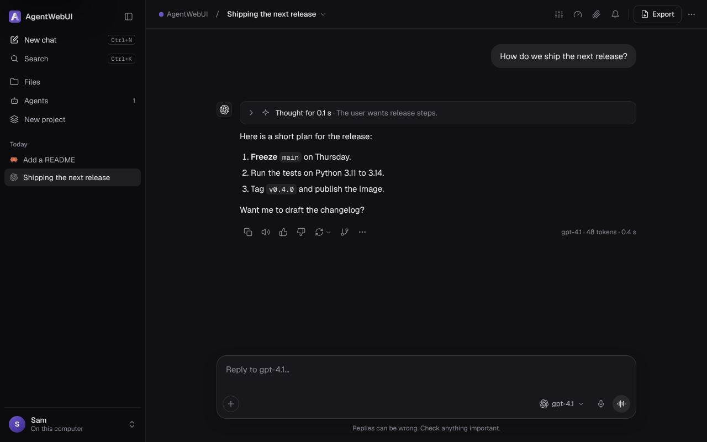
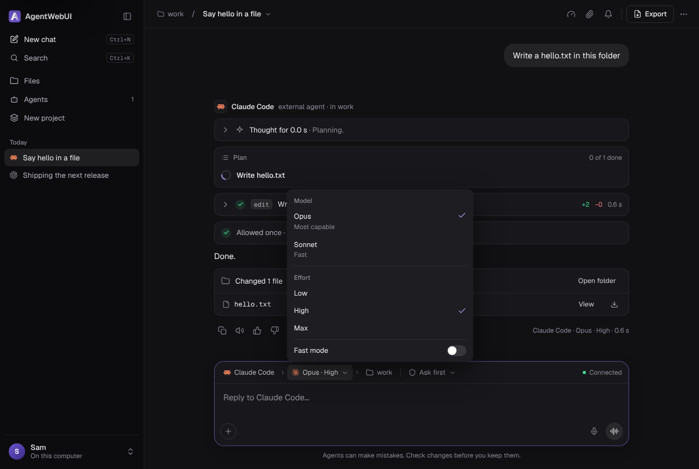
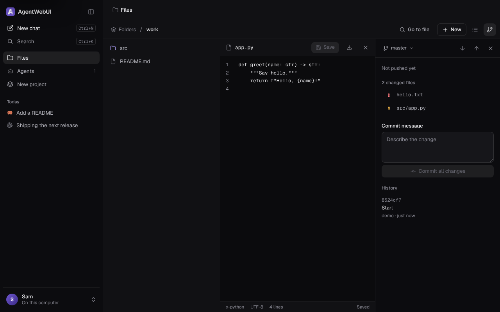
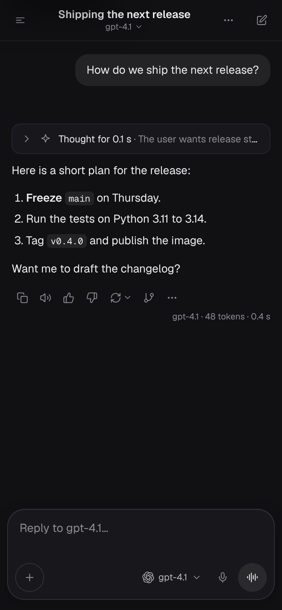

# [AgentWebUI](https://hackershostel.com/agentwebui)

[](https://github.com/HackersHostel/AgentWebUI/actions/workflows/tests.yml)

One small web page to chat with AI models and with command-line agents, on your own server. Open it and chat:
there is no setup screen and no accounts. Everything is configured in `.env`. The package and command are still
named `agentwebui-lite`.

- **Models:** any OpenAI-compatible API (OpenAI, OpenRouter, NVIDIA, Groq, Ollama, LM Studio, vLLM, …).
- **Agents:** anything that speaks the [Agent Client Protocol](https://agentclientprotocol.com) over stdio: Claude
  Code, Codex, Hermes, Pi, Gemini CLI, OpenCode, … Pick the agent, then **its** model and effort, then the folder it
  works in. It streams its thinking, plan, tool calls and diffs, and asks before it acts.

The server is about 3,000 lines of Python with one dependency (`aiohttp`) and uses about 40 MB of memory. The web
client is Preact through htm with no build step. Nothing loads from the internet unless you pick a font other than
Geist.

<p>
  
  
</p>
<p>
  
  
</p>

## What you can do

| | |
|---|---|
| **Chat** | Stream replies with reasoning; edit a sent message or regenerate, and flip between versions (‹ 2 / 3 ›); branch into a new chat from any reply; pin, archive, clone, export (Markdown or JSON); search everything with ⌘K. |
| **Temporary chat** | A chat that is never written to disk, never listed, and gone when you leave it. |
| **Files in** | Attach images, PDFs, text and code with +, by dropping them on the message box, by pasting, from your phone's camera, or from the server's files. Models get them as message parts; agents as ACP `image`, `resource` and `resource_link` blocks. |
| **Files and pictures out** | Images and files an agent sends appear in the chat. An image or file it writes in its folder and names in its reply (``) shows inline, and every file it changed is listed with a preview, View and Download. A model can hand you a file with a ```` ```file name="report.csv" ```` block; HTML and SVG code blocks have a Preview. |
| **Pickers** | A model or agent can ask you to choose with a ```` ```choices ```` block: single, multiple, confirm, text, scale, number, date, searchable list, ranking, or several questions with a review step. Your answer goes back as your next message. |
| **Agents** | The agent bar reads *agent › model › folder*, then the agent's mode. The model menu lists the agent's own models, effort and toggles (ACP `configOptions`); switch mid-chat, and the choice survives a restart. Type `/` for the agent's slash commands. |
| **Projects** | A folder, a default agent or model, and standing instructions. Chats are grouped under it in the sidebar. |
| **Files & Git** | Browse, view, edit, upload, rename and delete inside `FILES_ROOTS`; ⌘P go to file; search in files; `git` status, diff, commit, branch, pull, push and clone with the server's own Git sign-in. Start an agent chat in any folder. |
| **Voice** | Dictate into the message box, have replies read aloud, or talk hands-free in voice mode. It is the browser's own speech: audio never reaches the server. |
| **Notifications** | In-app and browser notifications when a reply finishes, fails or waits for you, and an optional webhook (Slack, Teams, ntfy, …) that works with every tab closed. |
| **Your brand** | Name, logo, greeting, theme and accent from `.env`; the page installs as an app on a phone or desktop. |

## Run it on your computer

On macOS or Linux, with Python 3.11+ and Git:

```bash
git clone https://github.com/HackersHostel/AgentWebUI.git && cd AgentWebUI
python3 -m venv .venv && .venv/bin/pip install -e .
cp .env.example .env        # then turn on a model provider or an agent (below)
.venv/bin/agentwebui-lite   # http://127.0.0.1:3000
```

Start it from this folder: it reads `.env` from the folder it starts in, and keeps its data in `data/` there. Stop
it with Ctrl+C. Without `PASSWORD` it answers only on this computer, so there is nothing to sign in to.

**A model.** In `.env`, take the `#` off a provider's lines. A model on your computer through
[Ollama](https://ollama.com) needs no key:

```bash
PROVIDER_OLLAMA_URL=http://127.0.0.1:11434/v1
```

A cloud API needs its key, for example `PROVIDER_OPENROUTER_URL=https://openrouter.ai/api/v1` and
`PROVIDER_OPENROUTER_KEY=sk-or-…`. The page lists what the provider's `/models` reports.

**An agent.** Agents are programs you install and sign in to yourself; AgentWebUI starts them when a chat needs one.
For Claude Code, install [Node.js](https://nodejs.org) (the adapter runs through `npx`), then sign in once in a
terminal:

```bash
npm install -g @anthropic-ai/claude-code
claude                      # then /login, then /exit
```

and add to `.env`:

```bash
AGENT_CLAUDE_COMMAND=npx -y @agentclientprotocol/claude-agent-acp
```

Codex is the same with `npm install -g @openai/codex` and `codex login`. [Agent setup](#agent-setup) has every agent.
An agent runs as you, with its own sign-in, so it must be signed in for the user that starts AgentWebUI.

**Where agents work.** Without `WORKSPACE_DIR`, a new agent chat starts in your home folder. Without `FILES_ROOTS`,
the Files page shows `WORKSPACE_DIR` (or your home folder) and each agent's `AGENT_<ID>_CWD`, and agent chats may only
work inside those. Set `WORKSPACE_DIR=~/code` or `FILES_ROOTS=~/code` to keep the Files page and new agent chats to
that folder. It doesn't fence the agent in: an agent you allow to run commands can reach whatever your user can.

**Check that it started.** It logs what it found, then the address:

```
INFO 1 model provider(s), 1 agent(s); data in /home/you/AgentWebUI/data
INFO open http://127.0.0.1:3000
```

`WARNING nothing to chat with yet` means no `PROVIDER_*` or `AGENT_*` line was read; check
[How `.env` is read](#how-env-is-read). If it stops at once with `agentwebui-lite: …`, see
[If it won't start](#if-it-wont-start). After you change `.env`, stop and start it again.

**Update** from the same folder, then start it again:

```bash
git pull && .venv/bin/pip install -e .
```

To work on AgentWebUI itself, see [CONTRIBUTING.md](CONTRIBUTING.md).

## Put it on a VPS

Two ways; both end with the app behind Caddy on HTTPS. Point a DNS name at the server first.

### Install script (systemd, lightest)

On a fresh Ubuntu 22.04+ or Debian 12+ server:

```bash
git clone https://github.com/HackersHostel/AgentWebUI.git && cd AgentWebUI
sudo DOMAIN=chat.example.com ./deploy/install.sh
```

It creates an `agentwebui` user, installs the app in `/opt/agentwebui-lite`, Claude Code and Codex with their ACP
adapters (`AGENTS=claude,codex`, or `AGENTS=` for none), writes `/etc/agentwebui-lite/.env` with a new password,
starts the `agentwebui-lite` service, puts Caddy in front for HTTPS (with streaming left unbuffered), and adds a daily
backup. It prints the address and the password. Then sign the agents in once, as the app's user:

```bash
sudo -iu agentwebui claude                     # then /login
sudo -iu agentwebui codex login --device-auth
```

Agents work in `/home/agentwebui/work` (`FILES_ROOTS`). Clone your repositories there from the Files page, or with
`sudo -iu agentwebui git clone …`. For pushing, give that user a deploy key: `sudo -iu agentwebui ssh-keygen -t
ed25519`, and add the public key to the repository. Run the script again to update.

Change settings in `/etc/agentwebui-lite/.env`, then `sudo systemctl restart agentwebui-lite`. Logs:
`journalctl -u agentwebui-lite -f`. Without `DOMAIN` the app answers only on `127.0.0.1`; reach it with
`ssh -L 3000:127.0.0.1:3000 your-server` or Tailscale.

### Docker

The image is published as `ghcr.io/hackershostel/agentwebui`, for amd64 and arm64:

| Tag | What's in it |
|---|---|
| `latest`, `X.Y.Z`, `X.Y` | The newest release (or that one), with Claude Code and Codex |
| `slim`, `X.Y.Z-slim`, `X.Y-slim` | The same without agents or Node.js: model providers only, and much smaller |
| `edge`, `edge-slim` | The newest `main`, rebuilt on every merge |

With Caddy in front for HTTPS, using the compose file in this repository:

```bash
cp .env.example .env    # set PASSWORD and your providers; agents are already installed in the image
mkdir -p work
DOMAIN=chat.example.com docker compose up -d   # pulls the image; add --build to build this checkout instead
docker compose exec app claude                  # sign Claude Code in once
docker compose exec app codex login --device-auth
```

Set `AGENTWEBUI_TAG=slim` (or a version, or `edge`) to run another tag. Update with `docker compose pull && docker
compose up -d`, or, if you build this checkout, `git pull && docker compose up -d --build`. Data lives in the `data`
volume, the agents' sign-ins in `home`, and your projects in `./work`.

To try it on your own computer without Caddy:

```bash
cp .env.example .env && mkdir -p work   # set PASSWORD: the container listens on all of its addresses
docker run -d --name agentwebui -p 127.0.0.1:3000:3000 -v "$PWD/.env:/app/.env:ro" \
  -v agentwebui-data:/data -v agentwebui-home:/home/agentwebui -v "$PWD/work:/work" \
  ghcr.io/hackershostel/agentwebui              # then open http://127.0.0.1:3000
docker exec -it agentwebui claude               # sign Claude Code in once
```

The image sets `HOST`, `PORT`, `DATA_DIR`, `WORKSPACE_DIR` and `FILES_ROOTS` for the container, and those win over the
same lines in the mounted `.env`. Set `TRUST_PROXY=true` only when a proxy sits in front, as the compose file does.

### Keep it safe

Whoever has the password can make an agent run commands on the server, as the app's user. Use a long password (the
install script makes one), keep `FILES_ROOTS` narrow, and consider putting the page behind Tailscale or Cloudflare
Access. Wrong passwords are limited to 8 per address per 10 minutes. Uploaded and agent-written files are served
sandboxed, so an HTML or SVG file can't run as the page.

## Data and backups

Everything AgentWebUI keeps is in `DATA_DIR`: `data/` in the folder it starts in, `/var/lib/agentwebui-lite` with
the install script, and the `data` volume (`/data` inside the container) with Docker.

| | |
|---|---|
| `chats.db` | Chats, messages, projects, the names of attached files, and the agents' cached options, in SQLite. While the server runs, `chats.db-wal` and `chats.db-shm` sit beside it; they are part of the database. |
| `files/` | The attachments and uploads themselves, and the images and files agents send into a chat |
| `secret.key` | Signs the sign-in cookie (with `PASSWORD`). Losing it, or changing `PASSWORD`, signs every browser out. |
| `backups/` | Copies made by `agentwebui-lite backup` |

Temporary chats are never written here, and files an agent writes in its folder stay in that folder.

`agentwebui-lite backup [FILE]` writes a consistent copy of `chats.db` while the server runs (to
`DATA_DIR/backups/` by default). **It copies only `chats.db`**: back up `files/` and `secret.key` as well, with your
usual tools. Files in `files/` are written once and never changed, so a plain copy is safe while the server runs.
Run the command with the same `.env` as the server: from the same folder, or with `AWL_ENV_FILE` (below). With
Docker, `docker compose exec app agentwebui-lite backup` writes to `/data/backups`.

The install script adds a daily cron job that keeps the 14 newest copies; for other setups, add this line yourself:

```
17 3 * * * agentwebui cd /var/lib/agentwebui-lite && AWL_ENV_FILE=/etc/agentwebui-lite/.env /opt/agentwebui-lite/.venv/bin/agentwebui-lite backup
```

To restore a backup:

1. Stop the server: Ctrl+C, `sudo systemctl stop agentwebui-lite`, or `docker compose stop app`.
2. In `DATA_DIR`, move `chats.db` out of the way **together with** any `chats.db-wal` and `chats.db-shm` beside it.
   A clean stop removes those two; if they are still there, they belong to the old database and must not be left
   next to the backup.
3. Copy the backup in as `chats.db`. If you backed up `files/`, put it back too; an attachment whose file is missing
   shows as not found.
4. Start the server again and check your chats are there.

On your computer, from the AgentWebUI folder, with the server stopped:

```bash
cd data && mkdir -p before-restore && mv chats.db* before-restore/ && cp backups/chats-20261025-031700.db chats.db
```

With the install script:

```bash
sudo systemctl stop agentwebui-lite
sudo -u agentwebui sh -c 'cd /var/lib/agentwebui-lite && mkdir -p before-restore && mv chats.db* before-restore/ && cp backups/chats-20261025-031700.db chats.db'
sudo systemctl start agentwebui-lite
```

With Docker:

```bash
docker compose stop app
docker compose run --rm --no-deps app sh -c 'cd /data && mkdir -p before-restore && mv chats.db* before-restore/ && cp backups/chats-20261025-031700.db chats.db'
docker compose start app
```

## Configure

Every setting is in [`.env.example`](.env.example). A value may name a variable from your shell as `${NAME}`.

```bash
PROVIDER_OPENROUTER_URL=https://openrouter.ai/api/v1
PROVIDER_OPENROUTER_KEY=${OPENROUTER_API_KEY}

AGENT_CLAUDE_COMMAND=npx -y @agentclientprotocol/claude-agent-acp
AGENT_CLAUDE_MODEL=sonnet          # where new chats start, until the browser remembers a choice
AGENT_CODEX_COMMAND=npx -y @agentclientprotocol/codex-acp
AGENT_HERMES_COMMAND=hermes acp

FILES_ROOTS=~/code,~/notes         # what Files shows and where agents may work
```

- An agent runs as the server's user, with this server's environment, so its own sign-in applies. Each agent chat
  has a folder inside `FILES_ROOTS`; the agent's file requests through ACP stay in that folder.
- An agent process stays up while you use it and stops after `AGENT_IDLE_MINUTES` (10) with nothing to do. Agents
  are much larger than this server (Claude Code about 370 MB, Codex about 580 MB), so this matters on a small machine.
- Without `PASSWORD` the server only answers on localhost. Set `PASSWORD` to listen on another address.
- To show the page inside another site, such as your own dashboard: list that site in `FRAME_ANCESTORS`, set
  `EMBED_SECRET`, and have the site open the frame at a one-time `/embed?token=…` link it signs
  ([docs/API.md](docs/API.md#signing-embed-links) shows how). `LOCK_MODEL` and `LOCK_FOLDER` hide the model and
  folder choices when the site decides them.
- `LOGIN_EMAIL` (with `PASSWORD`) makes sign-in ask for that email too, for a dashboard that hands out logins.
- Models and agents come only from `.env`; the browser switches between them, hides models you don't use, and
  remembers your defaults (Settings › Chat has "Reset to defaults"). `AGENT_<ID>_MODELS` limits an agent's model
  menu to the models you list, in that order.
- A model counts as local, and shows under the picker's **Local models** tab, only when its provider's address is on
  this machine or your network and Ollama, LM Studio, vLLM or llama.cpp's server answers there. Other engines on
  your machine (LocalAI, TGI, Jan, KoboldCpp, …) aren't recognised: add `PROVIDER_<ID>_LOCAL=true`, as in
  `PROVIDER_LOCALAI_LOCAL=true`. [Local models](#local-models) explains the check.

### Agent setup

Install each agent and sign it in as the user that runs AgentWebUI (`sudo -iu agentwebui …` with the install script,
`docker compose exec app …` with Docker). Commands that start with `npx` need [Node.js](https://nodejs.org).

| Agent | Install | Sign in once | `AGENT_<ID>_COMMAND` | Good to know |
|---|---|---|---|---|
| Claude Code | `npm install -g @anthropic-ai/claude-code` | `claude`, then `/login` | `npx -y @agentclientprotocol/claude-agent-acp` | The install script and the Docker image install the adapter, so there it is `claude-agent-acp` |
| Codex | `npm install -g @openai/codex` | `codex login`; on a server without a browser, `codex login --device-auth` | `npx -y @agentclientprotocol/codex-acp` | Likewise `codex-acp` with the install script and the image |
| Gemini CLI | `npm install -g @google/gemini-cli` | `gemini`, and sign in with Google; or set `GEMINI_API_KEY` | `gemini --acp` | Older versions take `--experimental-acp` instead; `gemini --help` shows which |
| OpenCode | `npm install -g opencode-ai` | `opencode auth login` | `opencode acp` | `opencode` must be on the server's `PATH` |
| Hermes | Its [install script](https://github.com/NousResearch/hermes-agent) | `hermes model` to choose a provider and model | `hermes acp` | Needs Hermes's ACP support; its docs say how to add it if `hermes acp` is missing |
| Pi | `npm install -g @earendil-works/pi-coding-agent` | `pi`, then `/login` | `npx -y pi-acp` | `pi` must be on the server's `PATH` |

Agents change faster than this table: if one won't start, its own `--help` and docs win. The agent's error shows in
the chat, and the server's log has the rest. Any other agent that speaks ACP over stdio works the same way.

### How `.env` is read

- **One `KEY=value` per line.** Lines starting with `#` are comments, `export KEY=value` works, and a value may be
  in `"double"` or `'single'` quotes.
- **In a value without quotes, a space and `#` start a comment.** `PASSWORD=abc #def` is read as `abc`. Put a value
  that contains ` #` in quotes: `PASSWORD="abc #def"`.
- **`${NAME}` is replaced with that variable** from the environment or the file, or with nothing when it isn't set.
- **The `<ID>` in `PROVIDER_<ID>_…` and `AGENT_<ID>_…` is capital letters and digits only.** A line of any other
  shape is ignored without a word: `PROVIDER_LM_STUDIO_URL` sets up nothing, `PROVIDER_LMSTUDIO_URL` works. If a
  provider or agent is missing, check its lines first.
- **Real environment variables win over `.env`.** A variable already set by your shell, a systemd unit or Docker
  replaces the same line in the file. The Docker image sets `HOST`, `PORT`, `DATA_DIR`, `WORKSPACE_DIR` and
  `FILES_ROOTS` this way.
- **`AWL_ENV_FILE` says which file to read.** Without it, `.env` in the folder the server starts in. The install
  script uses `/etc/agentwebui-lite/.env` and the Docker image `/app/.env`. Relative paths in the file, such as
  `DATA_DIR=data`, are relative to the folder the server starts in too.
- **Some values are cut short:** `BRAND_NAME` to 40 characters, `BRAND_GREETING` to 120, `USER_NAME` to 60.
- **Changes take effect on the next start.**

### Local models

The model picker's **Local models** tab lists the models that run on this server or on your own network. AgentWebUI
calls a model local only with two pieces of evidence:

1. **Its provider's address leads to this machine or your network.** The host in `PROVIDER_<ID>_URL` is looked up,
   and each of its addresses is one of:
   - *this machine*: a loopback address such as `127.0.0.1`, or an address of this server;
   - *your network*: a private address (`10.…`, `172.16.…`, `192.168.…`, `fd…`, link-local) or a `100.64.0.0/10`
     address such as Tailscale's, when this server reaches it from an address of the same kind, so it is on that
     network itself;
   - *the internet*: anything else, and any address this server has no route to or name that doesn't resolve.

   A name with several addresses counts as its least local one.
2. **A local engine it recognises answers there:** Ollama, LM Studio, vLLM or llama.cpp's server. Each is recognised
   by a reply only it gives, with the provider's key sent along.

So a gateway on this machine that forwards to the cloud, such as LiteLLM, is not local, and neither are Ollama's
cloud models (such as `gpt-oss:120b-cloud`), even through your own Ollama. The check runs in the background when the
server starts and every five minutes; Settings › Providers › Test all runs it at once. Until it ends, a provider is
not local. Agents never show under Local models: the app can't see where an agent's model runs.

**Engines it doesn't recognise aren't local until you say so.** LocalAI, Hugging Face TGI, Jan, KoboldCpp, TabbyAPI,
text-generation-webui and other servers aren't recognised, so their models stay out of Local models even on your own
machine. That is a gap in coverage, never a false claim: a model is only called local with evidence, or when you say
so:

```bash
PROVIDER_LOCALAI_URL=http://127.0.0.1:8080/v1
PROVIDER_LOCALAI_LOCAL=true
```

**And the other way:** `PROVIDER_<ID>_LOCAL=false` keeps a provider out of Local models, for example an Ollama
reached through a proxy on this machine that forwards to another one. The setting wins over the check both ways. It
takes `true` or `false` (or `yes`/`no`, `on`/`off`, `1`/`0`); anything else stops the server at start.

**Why it says local or not.** Each model's detail panel in the picker, and each provider in Settings › Providers,
give the reason in one line:

| Reason | What it means |
|---|---|
| `Local: Ollama answered at 192.168.1.20 (your network)` | Both pieces of evidence |
| `Local: marked local in .env` | `PROVIDER_<ID>_LOCAL=true` |
| `Not local: no known local engine answered at localhost:4000 (this machine)` | The address is local, but no engine it recognises answered: a gateway, or an engine it doesn't know. If the model really runs there, set `PROVIDER_<ID>_LOCAL=true`. |
| `Not local: api.example.com (203.0.113.7) is on the internet` | The address leads outside this machine and your network |
| `Not local: gpt-oss:120b-cloud is an Ollama cloud model, served from elsewhere` | Ollama answered, but runs this model somewhere else |
| `Not local: models.lan: its name did not resolve` | The host couldn't be looked up, so nothing proves it is local |
| `Not local: marked not local in .env` | `PROVIDER_<ID>_LOCAL=false` |

### If it won't start

A setting it can't work with stops it at once. It prints `agentwebui-lite:` and the reason, and exits with code 2;
under systemd the reason is in `journalctl -u agentwebui-lite`.

| It says | Do this |
|---|---|
| `HOST=0.0.0.0 is reachable from other machines: set PASSWORD in .env` | Set `PASSWORD`, or keep `HOST=127.0.0.1` |
| `LOGIN_EMAIL is asked for together with PASSWORD, so it needs PASSWORD too` | Set `PASSWORD`, or remove `LOGIN_EMAIL` |
| `EMBED_SECRET signs browsers in, so it needs PASSWORD too` | Set `PASSWORD`, or remove `EMBED_SECRET` |
| `EMBED_SECRET is too short: use at least 32 characters` | Make a long one, for example with `openssl rand -hex 32` |
| `FRAME_ANCESTORS takes full origins like https://app.example.com, not 'app.example.com'` | Write each one with `https://` (or `http://`) |
| `PROVIDER_<ID>_URL is missing` | Another `PROVIDER_<ID>_…` line is set without its URL: add the URL, or remove the leftover line |
| `AGENT_<ID>_COMMAND is missing` | The same for an agent: add its command, or remove the leftover line |
| `PROVIDER_<ID>_LOCAL takes true or false, not '…'` | Write `true` or `false` |
| `not a number: …` | `PORT` and `UPLOAD_MB` take whole numbers, `AGENT_IDLE_MINUTES` a number |

It can also start but not be reachable. `this server only answers on localhost` means there is no `PASSWORD` and
the page was opened by another name or address than `localhost` or `127.0.0.1`.

## API

Everything the page does goes through a JSON API that your own scripts can use too: chats, replies streamed as
server-sent events, files, projects and Git. [docs/API.md](docs/API.md) lists every route, how signing in works, the
events of a reply, and how a framing site signs `/embed` links.

## What it does not do

No accounts, roles or sign-up, no RAG or memory, no prompt library, no workflows, no MCP management, no sandbox, no
terminal and no web search of its own. Agents bring their own tools, memory, MCP servers and web search.

## Keyboard shortcuts

| | |
|---|---|
| `⌘N` / `Ctrl+N` | New chat |
| `⌘K` | Search chats, actions and settings |
| `⌘M` | Switch model (in an agent chat: the agent's model menu) |
| `⌘P` | Go to file (in Files) |
| `⌘\` | Collapse or expand the sidebar |
| `↵` | Send, or allow the waiting request |
| `⇧↵` | New line |
| `/` | The agent's slash commands (agent chats) |
| `Esc` | Stop the reply, or close the top layer |
| `?` | All shortcuts |

## Contributing

Questions go to [Q&A](https://github.com/HackersHostel/AgentWebUI/discussions/categories/q-a), ideas to
[Ideas](https://github.com/HackersHostel/AgentWebUI/discussions/categories/ideas), and bugs to
[issues](https://github.com/HackersHostel/AgentWebUI/issues/new/choose). Before your first pull request, read
[CONTRIBUTING.md](CONTRIBUTING.md): it covers setup, the rules that keep AgentWebUI small, and testing. Report security
problems privately, as [SECURITY.md](SECURITY.md) describes. Everyone taking part follows the
[Code of Conduct](CODE_OF_CONDUCT.md). What changed in each version is in [CHANGELOG.md](CHANGELOG.md).

## License

MIT. Copyright (c) 2026 HackersHostel. See the [LICENSE](LICENSE).
